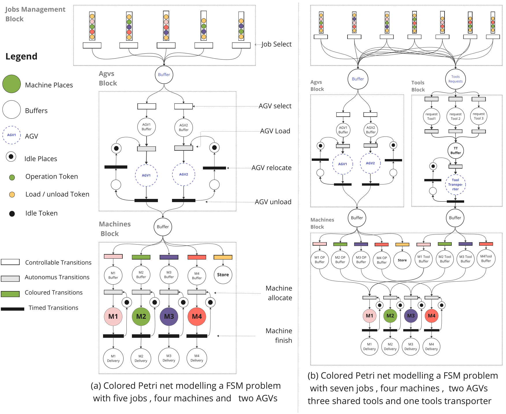

# PetriRL Intralogistics

Reinforcement learning for Flexible Manufacturing Systems (FMS) with intralogistics: job shop scheduling together with
automated guided vehicles (AGVs) and tool sharing. The shop is modeled as a colored timed Petri net and solved with
an actor-critic agent. Part of the [PetriRL framework](https://github.com/Sofiene-Uni/PetriRL-Framework).



- **Intralogistics**: AGVs carry jobs between machines and tool transporters share tools between machines.
- **Dynamic action masking**: Petri net guard functions remove infeasible AGV, tool and job assignments, which keeps
  the larger action space tractable.
- **Lookahead**: model-based rollouts on the Petri net choose where AGVs wait for their next transport.
- **Benchmarks**: small public FMS instances and a new large-scale benchmark inspired by Taillard.

## Getting Started

```bash
git clone https://github.com/Sofiene-Uni/PetriRL_Intralogistics.git
cd PetriRL_Intralogistics
pip install gymnasium numpy pandas matplotlib graphviz ipython sb3-contrib torch
```

```python
import gymnasium as gym
import ptrl

env = gym.make("ptrl-fms-v0", benchmark="Raj", instance_id="ra01", layout=1, n_agv=1, n_tt=1)
```

`n_agv` sets the number of AGVs, `n_tt` the number of tool transporters (0 disables tool sharing).
Benchmarks with AGVs and tools: `Raj` (small FMS instances) and `Solax` (large-scale, Taillard `ta01`-`ta80` as
`sl00`-`sl79` with tools).

## PetriRL Framework

This repository is one part of [PetriRL](https://github.com/Sofiene-Uni/PetriRL-Framework), one repository per paper:

- [PetriRL Framework](https://github.com/Sofiene-Uni/PetriRL-Framework): core package (`pip install petrirl`) and overview
- [PetriRL Studio](https://github.com/Sofiene-Uni/PetriRL-Studio): web app to train agents and replay their decisions
- [PetriRL Hyper-Heuristic](https://github.com/Sofiene-Uni/PetriRL_Hyperheuristic): RL selects dispatching rules
- [PetriRL DJSSP](https://github.com/Sofiene-Uni/PetriRL_DJSSP): random job arrivals and machine breakdowns
- [PetriRL Masking](https://github.com/Sofiene-Uni/PetriRL-Masking): action masking in highly constrained systems

## Citation

Developed by Sofiene Lassoued during his PhD at South Westphalia University of Applied Sciences (FH SWF).
If you use this work, please cite:

```bibtex
@article{lassoued2025intralogistics,
  title   = {Flexible Manufacturing Systems intralogistics: Dynamic optimization of AGVs and tool sharing using Colored-Timed Petri Nets and actor--critic RL with actions masking},
  author  = {Lassoued, Sofiene and Baheti, Laxmikant Shrikant and Wei{\ss}-Borkowski, Nathalie and Lier, Stefan and Schwung, Andreas},
  journal = {Journal of Manufacturing Systems},
  volume  = {82},
  pages   = {405--419},
  year    = {2025},
  doi     = {10.1016/j.jmsy.2025.06.017}
}

@article{lassoued2024petrirl,
  title   = {Introducing PetriRL: An innovative framework for JSSP resolution integrating Petri nets and event-based reinforcement learning},
  author  = {Lassoued, Sofiene and Schwung, Andreas},
  journal = {Journal of Manufacturing Systems},
  volume  = {74},
  pages   = {690--702},
  year    = {2024},
  doi     = {10.1016/j.jmsy.2024.04.028}
}
```
